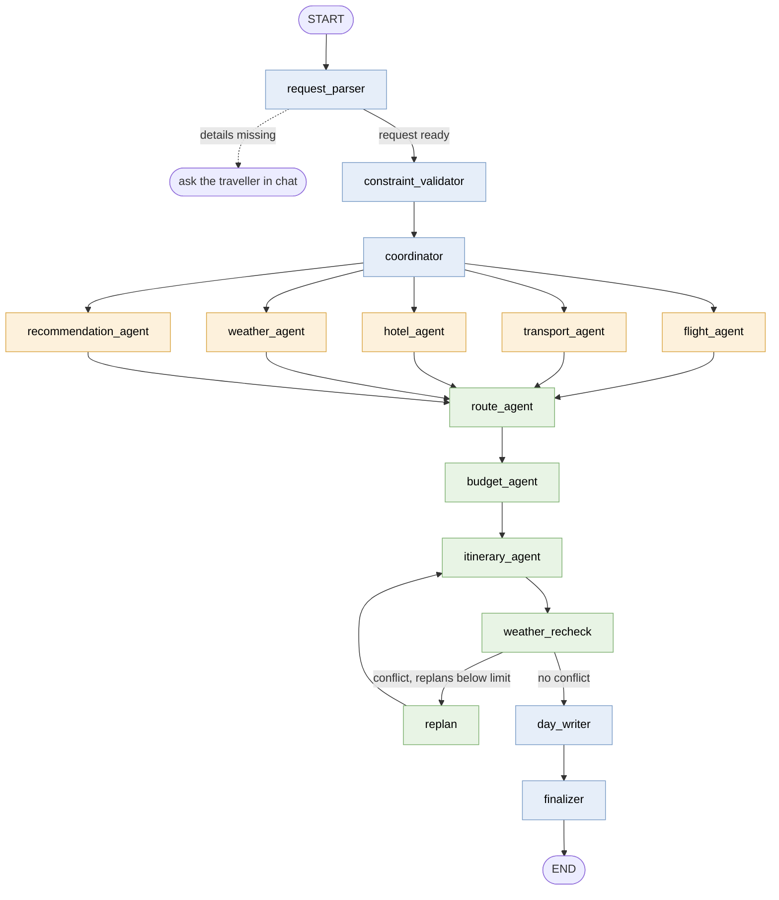
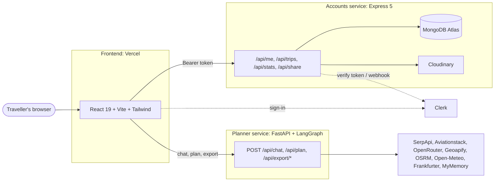
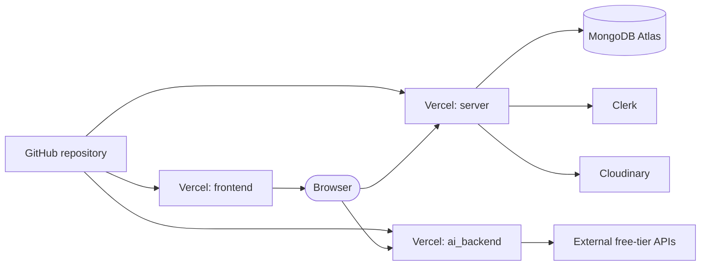

<div align="center">


# WorldTour AI

**An intelligent multi-agent travel planner.**
Describe a trip in plain language and get a day-by-day plan with maps, weather, costs and booking links.

[](https://worldtour-frontend.vercel.app/)


</div>

---

## Table of contents

- [About the project](#about-the-project)
- [Live deployment](#live-deployment)
- [Screenshots](#screenshots)
- [Features](#features)
- [How it works](#how-it-works)
- [Architecture](#architecture)
- [Repository layout](#repository-layout)
- [Tech stack](#tech-stack)
- [Getting started](#getting-started)
- [Environment variables](#environment-variables)
- [Tests and builds](#tests-and-builds)
- [Deployment](#deployment)
- [Security notes](#security-notes)
- [Known limitations](#known-limitations)
- [Roadmap](#roadmap)
- [Team](#team)
- [Acknowledgements](#acknowledgements)

## About the project

Planning a trip usually means juggling flight sites, hotel sites, weather apps, maps and spreadsheets. WorldTour AI replaces that with one conversation.

You type something like *"Plan a 3 day trip to Goa from Ahmedabad for 2 people, budget 60000 INR, beaches and food"*. A [LangGraph](https://langchain-ai.github.io/langgraph/) workflow of cooperating agents collects flights, ground transport, hotels, weather and attractions, prices three packages (Budget, Balanced and Premium), builds an hour-by-hour itinerary for every day, checks it against the forecast and returns the result with maps, costs and booking links.

The key design choice: **decisions that can be computed are computed by algorithms, not by a language model.** Ranking, budget packing, shortest paths and day scheduling use classic algorithms (priority queues, Top-K heaps, 0/1 knapsack, Dijkstra, A\*, greedy interval scheduling). The free language model is used only at the edges, to read a message when the built-in parser cannot, to suggest hotels when no hotel provider answers, and to write day descriptions. Every one of those uses has a fallback that works without it.

Signed-in travellers can save each finished itinerary to **My trips**, reopen it later, rename, favourite, archive, share it with a read-only link, and manage a profile.

> This is a final-year capstone project (B.Tech CSE-AIML, Karnavati University, Unitedworld Institute of Technology).

## Live deployment

| Service | URL |
| --- | --- |
| Website (frontend) | https://worldtour-frontend.vercel.app/ |
| Accounts API (`server/`) | https://worldtour-server.vercel.app/api/health |
| Planner API (`ai_backend/`) | https://worldtour-ai-backend.vercel.app/ |

The three services are deployed as three separate Vercel projects from this one repository.

## Screenshots

<table>
  <tr>
    <td width="50%"><br /><sub><b>Chat intake and plan overview</b></sub></td>
    <td width="50%"><br /><sub><b>Itinerary tab after saving</b></sub></td>
  </tr>
  <tr>
    <td width="50%"><br /><sub><b>Outbound and return flight options</b></sub></td>
    <td width="50%"><br /><sub><b>Hotels with rating, distance and price</b></sub></td>
  </tr>
  <tr>
    <td width="50%"><br /><sub><b>Day-by-day timetable with map</b></sub></td>
    <td width="50%"><br /><sub><b>Forecast and packing advice</b></sub></td>
  </tr>
  <tr>
    <td width="50%"><br /><sub><b>Cost breakdown and package totals</b></sub></td>
    <td width="50%"><br /><sub><b>Booking links and exports</b></sub></td>
  </tr>
  <tr>
    <td width="50%"><br /><sub><b>My trips library</b></sub></td>
    <td width="50%"><br /><sub><b>Sign-in with Clerk</b></sub></td>
  </tr>
</table>

## Features

**Planning**

- Natural-language trip requests, with a chat that asks for any missing details in one go.
- A feasibility check before planning: distance, number of days, cities, budget and dates, explained with numbers and a suggested fix.
- Three priced packages (Budget, Balanced, Premium) with flights or trains, hotels, food, local transport and paid activities.
- Hour-by-hour itinerary for each day with cab distance, time and fare, and a numbered map.
- Weather re-check: if the forecast conflicts with outdoor plans, the itinerary is rebuilt (at most twice) and any remaining conflicts are shown as warnings.
- Chat in Hindi, Gujarati and Marathi through translation.
- Export to PDF, text and calendar (`.ics`).

**Accounts**

- Sign-up, sign-in and Google sign-in through Clerk.
- **My trips**: every finished itinerary is saved with its plan versions, notes and favourite flag; reopen, rename, archive, delete.
- Read-only share link that shows no account details.
- Profile page with preferences and statistics.
- Guest mode: planning works without signing in; only saving needs an account.

**Engineering**

- Every external provider has a bounded retry and a labelled fallback. When data is missing the plan says so; nothing is invented.
- 211 automated tests that run offline with fake providers.

## How it works

The planner is a 15-node LangGraph `StateGraph`. Parallel agents collect data, then sequential agents combine it.



### Algorithms used

All algorithms are implemented in `ai_backend/src/worldtour_ai/algorithms/`.

| Component | Algorithm | Purpose |
| --- | --- | --- |
| Flight agent | Priority queue, sorting | Rank every option by a weighted score |
| Hotel agent | Heap, Top-K | Keep the best few hotels |
| Budget agent | 0/1 knapsack (dynamic programming) | Choose paid activities under the remaining budget |
| Route agent | Dijkstra, A\* (Haversine heuristic) | Shortest path on the route graph |
| Itinerary agent | Greedy interval scheduling | Drop overlapping activities within a day |
| Recommendation agent | BFS, DFS, Top-K | Walk a category graph of places and keep the best matches |
| Weather agent | Constraint checking | Compare outdoor activities with wet or stormy days |
| Coordinator | LangGraph `StateGraph` | The workflow itself is the control structure |

### Agentic concepts: what is and is not used

| Concept | Status |
| --- | --- |
| Multi-agent workflow (LangGraph) | Implemented |
| Tool calling (10 LangChain tools, called by agent code) | Implemented |
| Human-in-the-loop (clarification chat, confirm-before-plan) | Implemented |
| Short-term memory (per-chat session state) | Implemented |
| Retrieval-augmented generation (RAG) | Not used |
| ReAct-style reasoning loop | Not used |
| Long-term memory / learning from past trips | Planned, not implemented |

## Architecture



**Saving a finished itinerary.** The browser waits until the timetable is not empty, gets a session token from Clerk and sends `POST /api/trips`. The server verifies the token, ignores any owner id in the body, finds or creates the trip using the user and a client key (so retries never create duplicates), and the browser then syncs later changes with `PUT /api/trips/:id/sync`.

## Repository layout

| Folder | What it is | Stack |
| --- | --- | --- |
| [`frontend/`](frontend/README.md) | The website | React 19, TypeScript, Vite, Tailwind CSS 4, Clerk, zustand, React Router 7, Leaflet, Recharts |
| [`server/`](server/README.md) | Accounts API: profiles, photos, saved trips, sharing | Express 5, MongoDB Atlas (Mongoose), Clerk, Cloudinary, Zod, Svix, Helmet |
| [`ai_backend/`](ai_backend/README.md) | Trip-planning API and terminal app | FastAPI, LangGraph, LangChain tools, OpenRouter (free models only) |

Each folder has its own README with details: frontend setup, the server API table with step-by-step deployment, and the planner's agents, algorithms, providers and limitations.

## Tech stack

| Layer | Technologies |
| --- | --- |
| Frontend | React 19, TypeScript, Vite, Tailwind CSS 4, zustand, React Router 7, Leaflet, Recharts, Clerk React |
| Accounts server | Node.js, Express 5, Mongoose, MongoDB Atlas, Clerk, Cloudinary, Zod, Svix, Helmet |
| Planner service | Python 3.11+, FastAPI, LangGraph, LangChain tools, Pydantic, HTTPX |
| Language model | OpenRouter, free models only (the client refuses any non-free model) |
| Data providers | SerpApi (Google Flights and Hotels), Aviationstack, Geoapify, OSRM, Open-Meteo, Frankfurter, MyMemory |
| Testing and quality | pytest, `node:test` with Supertest, Vitest with Testing Library, TypeScript compiler, oxlint |
| Hosting | Vercel (three projects), MongoDB Atlas, Cloudinary |

## Getting started

### Prerequisites

Node.js 20 or newer, Python 3.11 or newer, and free accounts for the services you want to use: OpenRouter (planning text), Clerk (sign-in), MongoDB Atlas and Cloudinary (saved trips and photos). Planning works without Clerk, MongoDB and Cloudinary; the site then runs guest-only.

### Run everything locally

Copy each `.env.example` to `.env` in its folder and fill in your own values. Never commit `.env` files.

```bash
# 1. Planner API  ->  http://127.0.0.1:8000
cd ai_backend
python -m venv .venv
.venv\Scripts\activate            # macOS/Linux: source .venv/bin/activate
pip install -r requirements.txt
python scripts/serve.py

# 2. Accounts API  ->  http://localhost:5000/api/health   (optional: only for sign-in / My trips)
cd server
npm install
npm run dev

# 3. Website  ->  http://localhost:5173
cd frontend
npm install
npm run dev
```

For sign-in locally set `VITE_SERVER_URL=http://localhost:5000` and `VITE_CLERK_PUBLISHABLE_KEY=pk_test_...` in `frontend/.env`. If MongoDB cannot be reached, run `npm run check:db` in `server/`.

## Environment variables

Names only; see each `.env.example` for descriptions.

| File | Variables |
| --- | --- |
| `frontend/.env` | `VITE_API_URL` (planner API), `VITE_SERVER_URL` (accounts API), `VITE_CLERK_PUBLISHABLE_KEY` (all public) |
| `server/.env` | `PORT`, `DNS_SERVERS`, `MONGODB_URI`, `CLERK_PUBLISHABLE_KEY`, `CLERK_SECRET_KEY`, `CLERK_WEBHOOK_SIGNING_SECRET`, `CLOUDINARY_CLOUD_NAME`, `CLOUDINARY_API_KEY`, `CLOUDINARY_API_SECRET`, `CLOUDINARY_FOLDER`, optional `ALLOWED_ORIGINS`, `APP_URL` |
| `ai_backend/.env` | `OPENROUTER_API_KEY`, `OPENROUTER_FREE_MODEL`, `SERPAPI_API_KEY`, `AVIATIONSTACK_API_KEY`, `GEOAPIFY_API_KEY`, `OSRM_BASE_URL`, provider selectors, runtime and speed settings, optional `ACCESS_CODE`, `ALLOWED_ORIGINS`, `UPSTASH_REDIS_REST_*`, `PLANS_PER_DAY` |

## Tests and builds

```bash
cd frontend && npm test && npx tsc -b && npm run build && npm run lint
cd server   && npm test
cd ai_backend && pip install -e ".[dev]" && python -m pytest tests
```

All tests run offline; the server API suite downloads a temporary in-memory MongoDB the first time.

Result of the final recorded run:

| Suite | Tool | Tests | Passed |
| --- | --- | ---: | ---: |
| Planner (`ai_backend`) | pytest | 89 | 89 |
| Accounts server (5 files) | node:test | 50 | 50 |
| Frontend, pure rules (3 files) | node:test | 23 | 23 |
| Frontend, components (3 files) | Vitest | 49 | 49 |
| **Total** | | **211** | **211** |

The server file `api.test.js` (in-memory MongoDB) could not be run in that environment and is not counted. `tsc -b` and `vite build` passed, and `oxlint` reported 0 errors and 24 warnings. These are test results, not performance benchmarks.

## Deployment

Each folder deploys as its own Vercel project (root directory `frontend`, `server`, `ai_backend`). Environment variables, the Atlas network setting (`0.0.0.0/0`), the Clerk webhook and the order to set things up are in [server/README.md](server/README.md#deploy-vercel--step-by-step).



If the hosted site shows *"Couldn't reach WorldTour"*, check that `VITE_SERVER_URL` and `VITE_API_URL` point to the deployed services and that the server's `ALLOWED_ORIGINS` includes the frontend URL.

## Security notes

- Secrets live only in git-ignored `.env` files and in Vercel's environment settings.
- The server derives the user from a verified Clerk token and ignores any user id sent by the browser. Every trip query is scoped to that user.
- Another user's trip returns `404`; the share link exposes no account details.
- Passwords are never stored by this project; Clerk handles them.
- `helmet`, CORS allow-lists, request validation with Zod and rate limiting protect the API routes.

## Known limitations

- Prices come from free-tier providers and planning estimates; fares and hotel rates change quickly and are not live availability.
- Free-tier quotas (OpenRouter, SerpApi, Aviationstack) limit how many plans can be generated per day.
- Opening hours and ticket prices are not yet verified against an official source.
- Routing uses the public OSRM server and does not account for live traffic.
- No payments or bookings: booking links lead to the providers' own sites.
- No latency or accuracy benchmark against live providers has been run.

## Roadmap

- [ ] Long-term memory from saved trips (with consent) to suggest defaults
- [ ] Live hotel availability behind the existing provider interface
- [ ] Verified opening hours and ticket prices
- [ ] Traffic-aware routing
- [ ] Price-change alerts and booking hand-off
- [ ] Benchmarks and monitoring with live providers

## Team

**Group Techies** · Karnavati University, Unitedworld Institute of Technology · Guide: **Prof. Chiranjevi Dukuru**

| Member | Contribution |
| --- | --- |
| Keval Agrawal | AI agents and the coordinator |
| Dhruv Soni | AI agents and the coordinator |
| Harsh Moreshwar | Authorization and authentication APIs in a JavaScript framework |
| Rudra Chopda | Authorization and authentication APIs in a JavaScript framework |
| [Rachit Barapatre](https://github.com/rachit-barapatre) | Prompt testing to optimise agent responses and help the LLM provider get context |

## Acknowledgements

Thanks to our guide and the faculty of the B.Tech CSE-AIML program, and to the open-source communities and free-tier services this project builds on: LangGraph and LangChain, FastAPI, React, Vite, Clerk, MongoDB Atlas, Cloudinary, OpenRouter, SerpApi, Aviationstack, Geoapify, OSRM, Open-Meteo, Frankfurter and MyMemory.
